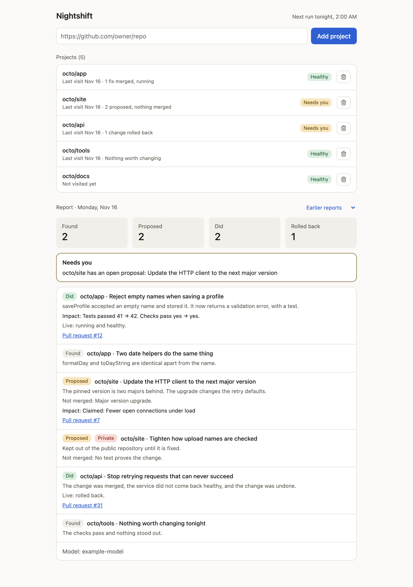

# Nightshift

Nightly upkeep for a list of GitHub repositories, with a report of what changed.

You keep a list of repositories. Each night Nightshift visits a few of them, has headless [Claude Code](https://claude.com/claude-code) look for bugs, security problems, stale dependencies and disorganization, and lets it make at most one small change per repository. Plain code, not the model, then decides whether that change may be merged, merges it only if the repository's checks pass, puts it live where the app runs on the same machine, and undoes it if the app does not come back healthy. In the morning there is a report of what it found, what it proposed, what it did, and the measured impact.

It does upkeep only. It is told not to add features.



The screenshot uses made-up repositories.

## Status

- **Web app:** working. Add and remove projects, read reports.
- **Nightly job:** implemented and covered by unit tests with every outside system faked. Cloning, installing, running a repository's checks inside the sandbox and reading the results have been exercised against real repositories. The model step has not: the job has **not yet completed a supervised run** with the real model, and the Claude Code flags it relies on were checked against the documentation only, so expect adjustments.
- **Schedule:** an installer exists for macOS. Run the job by hand first.
- **Platform:** the nightly job needs macOS, because that is where its sandbox comes from. The web app runs anywhere Node does.

## What it will and will not do on its own

A change is merged only when all of these hold. Otherwise it is left as a proposal with the reason.

1. The repository's own checks pass with the change, and the pull request's checks pass on GitHub.
2. No fewer tests run than before, and the change does not alter how the checks run.
3. It touches nothing sensitive: CI, deploy configuration, environment files, database migrations, package-manager or git configuration, agent instruction files, or anything that looks like sign-in or payment code.
4. It is not a major version upgrade.
5. A test proves it: the new test fails on the old code. The only exceptions are documentation, pure deletion of dead code, and a dependency patch that does nothing but move existing dependencies forward within their major version from the public npm registry.

Other limits: three projects a night, one at a time; at most one merged change per project per night; 45 minutes per project; at most three of its own pull requests open per project. A security change in a public repository is either merged the same night or never shown there. It is described only in your private report.

[docs/design.md](docs/design.md) explains how this works and why.

## Safety model

The model runs **without permission prompts**, because nobody is awake to answer them. What limits it instead:

- **It has no route to GitHub.** It works in a throwaway clone with no remotes. The job's own clone, which does all pushing and merging, is a separate folder the model cannot write to. Nothing in the model's `.git` folder is ever used by the job.
- **An OS sandbox** (macOS `sandbox-exec`) around the model and around every check run on code it touched. Inside it: writes only to the project's own working folders; no reading of credential folders (`~/.ssh`, `~/.config/gh`, `~/.aws`, keychains and others), your documents, or Nightshift's data folder; an environment with no tokens in it.
- **No direct internet.** The sandbox's only way out is a proxy the job runs, which connects to an allow-list of hosts (by default the Anthropic API and the npm registry) and records what it refused.
- **The merge rules above**, applied by code the model cannot influence.

What this does **not** cover, stated plainly:

- **Loopback is open inside the sandbox**, so a project's own tests can start a local server. That also means sandboxed code can call any service listening on `127.0.0.1` on the same machine. Do not run unauthenticated services on loopback that you would not want it to reach.
- The model can read its own Claude token. With the network allow-list this is hard to misuse, not impossible.
- An allow-listed host that accepts uploads is still a way to send data out.
- `sandbox-exec` is deprecated by Apple, though present on current macOS. Other platforms have no sandbox here; the job refuses to run there unless you set `allowUnsandboxed`.
- Checks that cannot run inside the sandbox (some browser tests, for example) will fail their baseline, and that project will only ever get proposals.

Text in a repository can be written by anyone, and a model can be talked into things. These limits reduce what a manipulated model could do. They do not make it impossible. In particular, the merge rules catch careless and mislabelled changes, not one written on purpose to pass them, so read what it merges.

## Prerequisites

- Node.js 25 or newer
- The [GitHub CLI](https://cli.github.com/) (`gh`), signed in. A project is accepted only if your account can push to it.
- For the nightly job: macOS, `git`, and Claude Code with a long-lived token from `claude setup-token`

## Install

```sh
git clone https://github.com/ichen27/nightshift.git
cd nightshift
npm ci
```

## Quickstart: the web app

Run the app against a throwaway data folder with the sample report:

```sh
export NIGHTSHIFT_DATA_DIR="$(mktemp -d)"
mkdir -p "$NIGHTSHIFT_DATA_DIR/reports"
cp tests/fixtures/report.json "$NIGHTSHIFT_DATA_DIR/reports/2026-01-05.json"
npm start
```

Open <http://127.0.0.1:8950>. Paste a repository link and choose "Add project" to add one; use the trash button to remove it.

## Running the nightly job

Use a data folder you keep. Everything Nightshift knows lives there: the project list, settings, reports, its clones.

1. Create `settings.json` in the data folder. `identity` is required; it authors every commit the job makes.

   ```json
   {
     "identity": { "name": "Your Name", "email": "you@example.com" },
     "projectsPerNight": 3
   }
   ```

2. Create a token with `claude setup-token` and save it as `claude-token` in the data folder, readable only by you.
3. Add a project in the web app, then look without touching anything:

   ```sh
   node src/cli.mjs run --only owner/repo --dry-run
   ```

   A dry run inspects and reports. It makes no changes, opens no pull requests and merges nothing.
4. Read the report in the app. When you are satisfied, run it for real on one project: `node src/cli.mjs run --only owner/repo`.
5. Only then install the schedule: `node scripts/install-schedule.mjs install`.

[docs/operations.md](docs/operations.md) covers every setting, the logs, going live with a process launcher, and how to stop everything.

## Configuration

| Variable | Meaning | Default |
|---|---|---|
| `NIGHTSHIFT_DATA_DIR` | The data folder. `APP_DATA_DIR` is used if this is not set. | required |
| `HOST`, `PORT` | Where the web app listens. | `127.0.0.1`, `8950` |
| `NIGHTSHIFT_ALLOWED_HOSTS` | Extra host names the web app answers to, comma-separated, for when it sits behind a proxy. Loopback on the chosen port is always allowed. | none |
| `NIGHTSHIFT_GH`, `NIGHTSHIFT_GIT`, `NIGHTSHIFT_CLAUDE`, `NIGHTSHIFT_NODE` | Paths to the tools, if they are not on `PATH`. | command names |

The web app has no sign-in of its own. Adding a repository gives the nightly job the right to change and merge code in it, so keep the app on loopback or behind a proxy that authenticates you. Requests for any other host name are refused, and changes are accepted only as JSON from the app's own page.

`launcher.example.json` is a manifest template for running the app under a process launcher; copy it to `launcher.json`, which is git-ignored.

## Validation

```sh
bash ci/run.sh
```

This installs from the lockfile, syntax-checks every source file and runs the tests. A few tests exercise the real macOS sandbox and are skipped elsewhere.

## Where things are

| Path | What |
|---|---|
| `src/` | The web app and the nightly job |
| `prompts/brief.md` | What the model is told |
| `public/` | The page |
| `launchd/`, `scripts/install-schedule.mjs` | The schedule |
| `tests/`, `tests/fixtures/` | Tests and sample data, including a sample report |
| `docs/` | Design, operations, screenshot |

## Contributing

See [CONTRIBUTING.md](CONTRIBUTING.md). Agents and contributors should read [AGENTS.md](AGENTS.md) first.

## License

[MIT](LICENSE)
